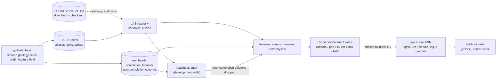

# well-log-production-ml

[](https://github.com/Avinash186200/well-log-production-ml/actions/workflows/ci.yml)
[](LICENSE)


Rank planned oil wells by expected first-12-month production from well logs, completion design and location. It starts with a data-readiness audit, then compares a type curve and a nearest-neighbour baseline with LightGBM (Tweedie loss), and scores everything with random, pad-grouped, spatial-block and leave-field-out cross-validation, to show how much random CV flatters a model when wells cluster in space.

## Scenario

An upstream operator has a list of planned wells and a budget for only some of them. It wants to rank the candidates by expected first-12-month cumulative oil, using what is known before drilling: logs from a pilot hole through the target zone, the planned completion (lateral length, proppant, stage spacing) and the location. Two questions come first. Is there enough clean data to try, once you require the log curves the features need? And how good will the ranking really be on new wells, given that wells sit on shared pads and nearby wells produce alike, so a random train/test split puts each well's neighbours in the training set?

This is a scenario to frame the work, not a real project. The production model runs on a **synthetic basin** generated in this repo, because no public dataset I could verify has logs, completion data and early production for the same wells under an open licence (details under Limitations). The log audit also runs on **real public logs**: the FORCE 2020 North Sea dataset (118 wells, CC BY 4.0).

## What it does

| part | what I built | how it is checked |
|---|---|---|
| synthetic basin | 9 fields, 137 pads, 718 horizontal wells; smooth random fields for porosity, net-to-gross, water saturation, thickness and depth; a fracture-intensity field and a pad effect that change production but are not in the logs; later pads further out; Gamma noise and a zero-inflated target | tests on determinism, split rules, target shape; an oracle that ranks by the true expected value |
| LAS logs | each well's pilot log written as LAS 2.0 with vendor-specific mnemonics, mixed and mislabelled units, spikes, NULL gaps, missing curves on older wells, logs that start inside the zone | a small LAS reader that refuses files it cannot read (wrapped files, column mismatch) instead of half-reading them |
| curve clean-up | alias map to canonical curves (GR, RHOB, NPHI, RT, DT, CALI); units judged from values as well as labels (kg/m3 vs g/cm3, percent vs fraction, us/m vs us/ft); out-of-range samples set to NaN and counted | unit tests per conversion, including a percent curve labelled V/V |
| readiness audit | missing and impossible values, curve coverage of the target zone and how many wells survive each extra curve requirement, unit fixes, spikes, target zeros and skew, leakage candidates (from the data dictionary and from rank correlation), wells per pad, a correlogram and Moran's I | run on development wells only; the same log-inventory code runs on FORCE 2020 |
| features | per-well summaries over the target zone (P10/P50/P90, mean, std of each curve), shale volume, porosity, Archie water saturation, net pay, hydrocarbon pore thickness; planned completion; x, y, depth | petrophysics tests on hand-built logs; a well's features depend on that well only |
| models | type curve (field median oil per metre times lateral), kNN on location, LightGBM Tweedie, LightGBM on log1p(y), LightGBM quantile models for P90 / P50 / P10 | Spearman, top-decile capture, MAE in barrels, bias ratio, quantile coverage |
| validation | random 5-fold, grouped by pad, spatial 10 km blocks, leave one field out, all on development wells; settings chosen by spatial-block CV; held-out wells (completed 2022 onwards) scored once | a test that the selection is the best block-CV score; a full rerun checked against the committed results |

## How it works



The development/held-out split is by completion year: wells completed before 2022 are for development (578 wells, 112 pads), wells from 2022 onwards are held out (140 wells, 25 pads). Pads near a field centre were drilled first, so the held-out wells are newer, mostly on the outer edge, and all on pads with no development well. That is the realistic case for a drilling programme: you rank new locations, often step-outs.

## Results

All numbers are from [results/RESULTS.md](results/RESULTS.md) and the JSON files next to it. `make bench` rebuilds every synthetic number in about 1.5 minutes on a laptop CPU, and CI checks that a fresh run matches the committed JSON (with the library versions in `constraints.txt`). The FORCE 2020 numbers are rebuilt in CI from the committed per-well sample; `make force` rebuilds the sample from the original download.

### 1. Data readiness (synthetic, 578 development wells)

From `results/audit.json`:

| requirement (curve covers >= 80% of the zone) | wells left |
|---|---|
| GR | 551 |
| + RHOB | 539 |
| + RT | 539 |
| + NPHI | 431 |
| + DT | 174 |

- **Curves.** Three vendors' names map to each curve (GR / GRC / SGR, RHOB / ZDEN / DEN, ...). 27 wells have a GR curve that misses part of the zone because the log starts inside it.
- **Units.** 17 density curves were in kg/m3 (12 of them labelled as g/cm3), 108 neutron curves in percent (22 of them labelled V/V), 26 sonic curves in us/m. All converted; mislabelled ones counted under `declared_unit_wrong`.
- **Leakage.** The data dictionary marks four columns as recorded after completion (`ip30_bopd`, `peak_month_oil_bbl`, `cum6_oil_bbl`, `water_cut_3m`). Three of them also have a rank correlation with the target above 0.9 (`ip30_bopd` 0.996, `peak_month_oil_bbl` 0.989, `cum6_oil_bbl` 0.999), which is what the data-side check flags; early water cut (-0.160) is caught only by the dictionary. None is a feature.
- **Target.** 11.8% zeros, median 42,176 bbl, 99th percentile 225,594 bbl, skew 1.79: a Tweedie-shaped target.
- **Spatial clustering.** 3 to 8 wells per pad (median 5), nearest neighbour 0.3 km. The rank correlation of two wells' outcomes is 0.45 to 0.50 within 2 km, 0.34 at 5 to 10 km and about zero beyond 10 km; Moran's I (k = 5) is 0.50 with a permutation p-value of 0.005 (199 permutations, the smallest possible). This is why the spatial blocks are 10 km.

So the answer to "is there enough clean data?" depends on the feature set. Requiring the sonic log would cut the training set to 174 wells; the petrophysical features need only GR, RHOB and RT (539 wells), and LightGBM takes the rest as missing values.

### 2. How optimistic is each CV scheme? (development wells, pooled out-of-fold)

The same model settings (chosen by spatial-block CV) scored four ways. n = 578 wells in every row; top decile = 58 wells (`top_decile_wells`). s.e. = standard deviation over 1,000 pad-level bootstrap resamples of the pooled out-of-fold predictions; it treats the fitted models as fixed, so it covers which wells were sampled, not refitting noise. From `results/cv.json` -> `selected_under_each_scheme`:

| CV scheme | median distance from a test well to the nearest training well | kNN on location: Spearman (s.e.) | type curve | LightGBM Tweedie: Spearman (s.e.) | top-decile capture | MAE bbl |
|---|---|---|---|---|---|---|
| random 5-fold | 0.3 km | 0.641 (0.044) | 0.581 | **0.760** (0.025) | 0.822 | 23,406 |
| grouped by pad | 1.7 km | 0.609 (0.043) | 0.554 | 0.747 (0.025) | 0.758 | 24,150 |
| spatial 10 km blocks (by pad centroid) | 4.7 km | 0.458 (0.058) | 0.521 | 0.709 (0.029) | 0.767 | 25,893 |
| leave one field out | 17.9 km | -0.190 (0.079) | -0.061 | 0.667 (0.032) | 0.676 | 28,529 |
| oracle: true expected value (nothing fitted) | - | - | - | 0.841 | 0.866 | 17,792 |

- **Random K-fold gives the highest estimate for every model except the log-target one** (0.627 random vs 0.636 by pad; full table in RESULTS.md). The median test well has a training well 300 m away, usually a pad-mate. The kNN baseline, which is nothing but "copy the neighbours", drops from 0.641 to 0.458 once the nearest training well is a median 4.7 km away, and has no skill in a new field (pooled -0.19, mostly from getting field levels wrong; within-field Spearman about 0.06, `within_field_mean_spearman`). Under leave-field-out LightGBM keeps a within-field Spearman of 0.546, the type curve 0.234.
- **LightGBM loses less** (0.760 to 0.709 to 0.667) because most of its signal comes from the logs and the completion, which travel to new places; the location part does not.
- **Hyperparameter choice was not hurt by random CV here.** Random CV and block CV picked the same setting (`num_leaves=15, min_data_in_leaf=40, num_rounds=100, tweedie_variance_power=1.2`), and the 16 grid settings span only 0.680 to 0.709 under block CV. The block-CV 0.709 is the best of those 16 settings scored on the same out-of-fold predictions, so it is itself slightly optimistic. The damage from random CV in this basin is the inflated estimate, not a worse model.

### 3. Held-out wells (completed 2022 onwards, scored once)

n = 140 wells on 25 pads, all on new pads, median 2.7 km from the nearest development well; zero share 7.9%; top decile = 14 wells. s.e. = pad-level bootstrap, 1,000 resamples. From `results/holdout.json`:

| model | Spearman | s.e. | top-decile capture | s.e. | MAE bbl | s.e. | bias ratio |
|---|---|---|---|---|---|---|---|
| type curve | 0.345 | 0.102 | 0.455 | 0.092 | 41,508 | 5,567 | 0.811 |
| kNN on location (k = 10) | 0.361 | 0.115 | 0.397 | 0.101 | 41,692 | 5,836 | 0.808 |
| **LightGBM Tweedie (selected)** | **0.587** | 0.066 | **0.666** | 0.070 | **34,286** | 4,664 | 0.893 |
| LightGBM on log1p(y) | 0.523 | 0.079 | 0.652 | 0.112 | 45,300 | 6,209 | 0.606 |
| LightGBM Tweedie, no x/y | 0.595 | 0.061 | 0.750 | 0.072 | 33,032 | 4,364 | 0.894 |
| oracle: true expected value | 0.763 | 0.050 | 0.941 | 0.042 | 22,380 | 2,600 | 0.981 |

Picking 14 wells at random would capture about 0.34 of the top decile's oil (`random_pick_capture_expected`).

- **LightGBM beats both baselines by a wide margin.** Spearman 0.587 against 0.345 to 0.361; the gap is about two or more standard errors of either estimate (these s.e. are not for the difference, so read this as indicative).
- **Every CV scheme overestimated the held-out Spearman**, random CV the most (0.760 vs 0.587). Part of the gap is that the held-out wells are harder to rank, not only CV optimism: even the oracle drops from 0.841 on development wells to 0.763 here. Measured against the oracle (`tweedie_share_of_oracle_spearman`), LightGBM reaches 0.77 of the ceiling on held-out wells; random CV promised 0.90, pad CV 0.89, block CV 0.84 and leave-field-out 0.79, so leave-field-out was the closest estimate.
- **Location features did not help on new pads.** Without x and y, Spearman is 0.595 and capture 0.750, against 0.587 and 0.666 with them. The differences are within about one standard error, so I read this as "no gain", not a loss. kNN on location is no better than the type curve.
- **The log-target model is worse on every measure.** With 8 to 12% zeros, a model of log1p(y) is pulled towards zero: it predicts something closer to a geometric mean, so its predictions add up to only 0.61 of the actual total (bias ratio 0.606) and even its MAE is the worst of the fitted models. Tweedie handles exact zeros and the long tail directly.
- **Tweedie under-predicts the held-out total** (bias ratio 0.893). Held-out wells have bigger completions (median proppant 1,558 vs 1,162 kg/m), almost all inside the development range (1.4% of laterals and no proppant values above the development maximum, `share_above_dev_max`) but in its thin upper part, and trees predict flat at the edge of what they have seen.

Quantile models (P90 = the value exceeded with 90% probability = the 10th percentile, the industry convention):

| | share of actuals below P90 (nominal 0.10) | below P50 (0.50) | below P10 (0.90) | inside P90-P10 (0.80) | n |
|---|---|---|---|---|---|
| held-out | 0.100 | 0.521 | 0.814 | 0.714 | 140 |
| development, block CV out-of-fold | 0.182 | 0.528 | 0.848 | 0.666 | 578 |

The ranges are too narrow: 71% and 67% coverage against a nominal 80%. On held-out wells the problem is the upper tail: 81% of wells fall below P10 instead of 90%.

The largest mean |SHAP| values on held-out wells (log scale, `mean_abs_shap_top10`) are mean density (0.189), hydrocarbon pore thickness (0.138) and lateral length (0.103), which matches how the generator builds production (rock quality times completed length), though the model never sees the generator.

### 4. Real logs: FORCE 2020 (118 North Sea wells, audit only)

From `results/force2020.json`, rebuilt in CI from `samples/force2020_wells.csv`. The interval per well is from the first to the last gamma-ray sample, because the files have no target zone.

| requirement | wells (curve covers >= 80% of the interval) | wells (>= 50%) |
|---|---|---|
| GR | 118 | 118 |
| + RHOB | 34 | 82 |
| + RT | 34 | 82 |
| + NPHI | 13 | 53 |
| + DT | 12 | 51 |

- **Coverage, not presence, is the constraint.** Every file has some data for all five main curves, but over different intervals: density covers 80% of the gamma-ray interval in only 34 of 118 wells: density and neutron logs are run over the reservoir section, gamma ray over most of the hole. An honest "how many wells do we have?" depends on which interval you need. GR survives in all 118 wells by construction, because the interval is defined by GR.
- **Spikes and odd values are common in real data.** 71 wells have density samples outside 1.5 to 3.1 g/cm3 (33,666 samples in all), 27 wells have sonic values outside 35 to 200 us/ft. The GR range allows up to 500 gAPI because organic-rich shales read above 300.
- **A gamma-ray sand flag is a poor lithology proxy here.** Flagging samples as clean when the GR index is below 0.4 (endpoints at each well's 5th and 95th percentiles) finds 74% of the samples geologists labelled sandstone, but only 30% of flagged samples are sandstone; the largest group of false "clean" samples is shale (167,737), then sandstone/shale, limestone and marl. Per-well sand fractions from the two methods barely agree (Spearman 0.10 over 118 wells). Per-well GR scaling is the main culprit: in a well with very hot shales, ordinary shale scales as clean.
- **Wells are far apart.** Median nearest-neighbour distance is 7.7 km; only 4 of 118 wells have a neighbour within 2 km. These are exploration and appraisal wells, unlike the 300 m pad spacing of a development programme.

## Key concepts

- **Tweedie loss.** A distribution family with a point mass at zero and a continuous right tail (for variance power between 1 and 2), fitted on the log scale by LightGBM. It predicts the mean, so totals come out right on average, and it needs no log transform that would mishandle zeros.
- **Top-decile capture.** Actual oil from the wells the model ranks in its top 10%, divided by actual oil from the true top 10%. It answers "if we drill the model's best tenth, how much of the best possible do we get?".
- **Grouped and spatial CV.** Grouped CV keeps every pad whole on one side of a split. Spatial-block CV cuts the map into 10 km squares, assigns each pad to the square of its centroid, and keeps each square whole. Leave-field-out holds out a whole field. Each step pushes test wells further from their training neighbours (0.3, 1.7, 4.7, 17.9 km).
- **Development vs held-out.** Every choice (curve rules, feature list, model grid, kNN k, block size, the selection rule) was fixed on development wells. The held-out wells were scored once, in one run.
- **Leakage candidates.** Columns that exist only after the well is on production (first-30-day rate, 6-month cumulative, peak month, early water cut). They are flagged twice: by the data dictionary's "available" field, and by a rank correlation above 0.9 with the target. Neither is a feature.
- **Petrophysical proxies.** Shale volume from the gamma-ray index, density-neutron porosity, Archie water saturation (a = 1, m = n = 2, Rw = 0.05 ohm.m), net pay by cut-offs (Vsh < 0.4, phi > 0.06, Sw < 0.6), hydrocarbon pore thickness = sum of phi (1 - Sw) dz over pay.
- **Pad bootstrap.** Wells on a pad are correlated, so standard errors resample whole pads, not wells.
- **P90 / P50 / P10.** Industry naming: P90 is the low case (90% chance of beating it), P10 the high case.

## Quick start

```bash
pip install -c constraints.txt -e ".[dev]"   # exact versions the results were made with
pytest -q                                     # about 2 min; includes a full rerun against results/
make bench                                    # writes results/{data,audit,cv,holdout,force2020}.json and RESULTS.md
make simulate                                 # the synthetic basin as wells.csv + one LAS file per well
make force                                    # optional, needs network: download FORCE 2020 (~170 MB), verify MD5 + SHA-256, rebuild the sample
```

On Linux, LightGBM needs the OpenMP runtime (`libgomp1`; already on GitHub's Ubuntu runners). The method is in [docs/methodology.md](docs/methodology.md) and a step-by-step tour in [docs/walkthrough.md](docs/walkthrough.md).

## Layout

```
src/wellprod/
  synth.py      synthetic basin: geology fields, pads, LAS logs with defects, completion, target
  las.py        LAS 2.0 reader and writer (unwrapped files)
  curves.py     mnemonic aliases, unit checks, spike flags, zone coverage
  audit.py      readiness audit: inventory, survival chain, leakage, correlogram, Moran's I
  features.py   zone summaries, petrophysics, completion and location features
  cv.py         random, pad-grouped, spatial-block and leave-field-out splits
  models.py     type curve, kNN on location, LightGBM (Tweedie, log1p, quantile)
  metrics.py    Spearman, top-decile capture, MAE, bias ratio, quantile calibration, pad bootstrap
  force2020.py  FORCE 2020 download with checksums, per-well audit rows, summary
  bench.py      the full run and the RESULTS.md renderer
  cli.py        wellprod simulate | bench | report | force-download | force-sample | force-report
samples/        force2020_wells.csv (one row per FORCE well, 60 KB) and its licence notice
results/        JSON results and RESULTS.md
tests/          unit tests per module, a small end-to-end run, a full rerun against results/
docs/           methodology, walkthrough
```

## Limitations

- **The production model is tested on synthetic data only.** I looked for a public dataset with logs, completion and early production for the same wells under a clear open licence and did not find one I could verify: FORCE 2020 has logs and lithology but no production; the Volve field data release covers a single field with production for only a handful of wells, under its own licence terms; US state production data is per lease or behind access terms in several states. The generator's production law is mine, so the model is being tested on a world whose structure (rock quality times lateral, a hidden fracture field, a pad effect) I chose. Real basins have parent-child well interference, operator differences, choke management and price-driven shut-ins that are not here.
- **The held-out set is one draw.** 140 wells on 25 pads gives Spearman standard errors of 0.05 to 0.12. Differences smaller than about two standard errors (for example with vs without x/y) are not findings.
- **The held-out gap mixes two things.** CV optimism and a harder held-out population (newer completions, outer pads, a lower oracle ceiling). I report the oracle so the two can be separated roughly, not exactly.
- **Spatial blocks are not a buffer.** A 10 km block can still have a training well just across its edge (10% of block-CV test wells are within 2.0 km of a training well). Leave-field-out is the strict version; a buffered spatial CV would sit between the two.
- **The synthetic logs are cleaner than real ones.** The FORCE audit shows real coverage, spike rates and lithology mixes that the generator does not imitate (carbonates, hot shales, washouts). The petrophysical constants (GR endpoints, matrix density, Rw, Archie exponents, cut-offs) match the generator by construction; on real data they have to be set per formation by a petrophysicist.
- **The GR sand flag check uses per-well scaling** and a single cut-off over whole wells; a formation-by-formation interpretation would do better. It is there to show that a naive proxy needs checking, not as a best attempt.
- **The quantile ranges are too narrow** (66% to 71% coverage for a nominal 80%), and the quantile models reuse the Tweedie model's tree settings without their own tuning. They are not ready to quote as P90 / P10 without calibration (for example conformal adjustment on spatial-CV residuals).
- **Trees do not extrapolate, and development CV is not point-in-time.** Completion designs keep growing in real basins; a model trained on older wells will under-predict bigger new completions, as the 0.893 bias ratio shows. The development CV folds mix completion years, so they never ask the model to predict a later year than it trained on. And `completion_year` is outside the development range (2014-2021) for every held-out well (2022-2024), so the trees treat all of them as 2021. A forward-chaining CV (train on earlier years, test on the next) would measure this; it is not included.
- **No time dimension.** The target is a single 12-month number. A production-decline model per well (rate versus time) would use more of the data.

## License

MIT. See [LICENSE](LICENSE). The FORCE 2020 derived sample in `samples/` is CC BY 4.0 (https://creativecommons.org/licenses/by/4.0/), from Bormann, Aursand, Dilib, Manral and Dischington (2020), "FORCE 2020 Well well log and lithofacies dataset for machine learning competition" (v1), Zenodo, https://doi.org/10.5281/zenodo.4351156; it contains data under the Norwegian licence for Open Government data (NLOD) 2.0. See `samples/NOTICE.txt`.
